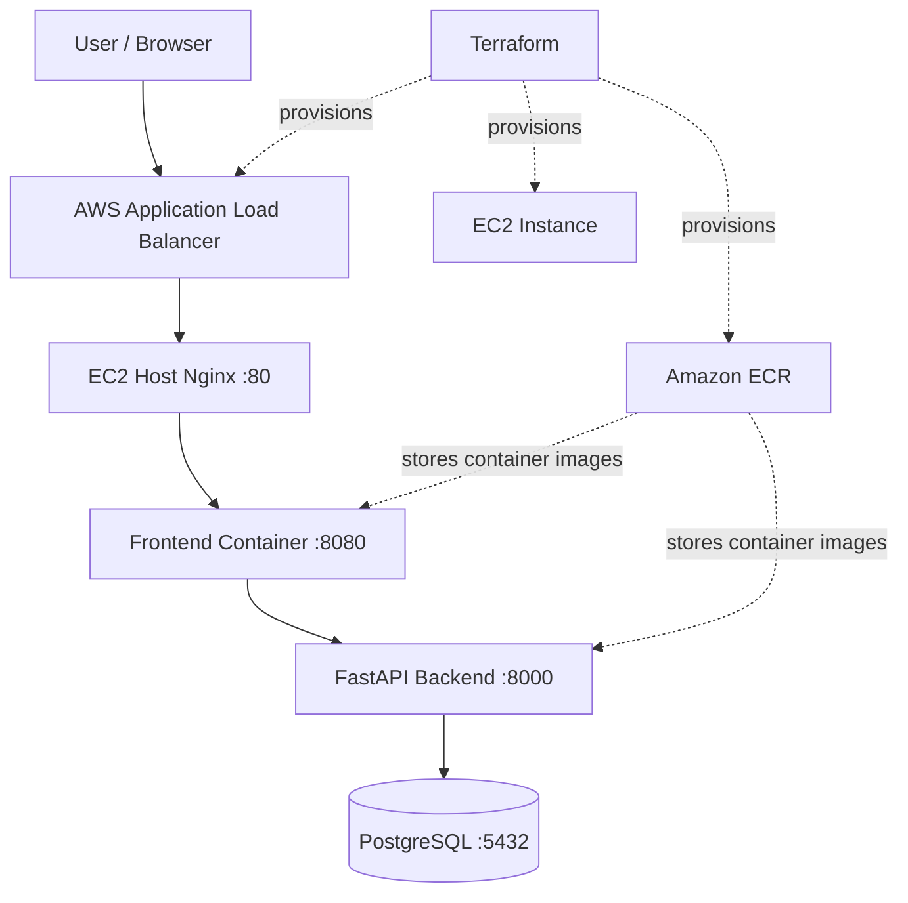

# Cloud-Native Todo Platform

A full-stack application deployed on AWS, built to demonstrate practical **Platform Engineering, Infrastructure as Code, containerization, cloud networking, and application operations**.

The project takes a React frontend, FastAPI backend, and PostgreSQL database from application code to a working AWS deployment using Docker, Amazon ECR, Amazon EC2, an Application Load Balancer, and Terraform.

## Architecture



### Technology stack

| Area                          | Technologies                                                       |
| ----------------------------- | ------------------------------------------------------------------ |
| Frontend                      | React                                                              |
| Backend                       | Python, FastAPI                                                    |
| Database                      | PostgreSQL                                                         |
| Containerization              | Docker, Docker Compose                                             |
| Infrastructure as Code        | Terraform                                                          |
| Cloud                         | AWS EC2, Application Load Balancer, ECR, IAM, VPC, Security Groups |
| Instance management           | AWS Systems Manager (SSM)                                          |
| Web serving and reverse proxy | Nginx                                                              |
| Version control               | Git, GitHub                                                        |

## Implemented capabilities

* **Infrastructure as Code:** AWS infrastructure is defined and managed using Terraform.
* **Containerized application:** Frontend, backend, and database run as separate containers.
* **Container registry:** Application images are stored in Amazon ECR.
* **Load-balanced entry point:** An AWS Application Load Balancer provides the application entry point.
* **Reverse proxy:** Nginx routes incoming HTTP requests to the frontend container.
* **Service communication:** The frontend communicates with FastAPI, which connects to PostgreSQL over the Docker network.
* **Database persistence:** PostgreSQL data is stored in a named Docker volume.
* **Health checks and startup ordering:** Docker Compose checks database readiness before starting the backend.
* **Access control:** EC2 uses an IAM instance profile for AWS Systems Manager and read-only ECR access.
* **Operational validation:** Deployment is verified through container status, health checks, Nginx validation, and application smoke tests.

## Repository structure

```text
cloud-native-todo-platform/
├── backend/                  # FastAPI application
├── frontend/                 # React application
├── terraform/                # AWS infrastructure definitions
├── docker-compose.yml        # Application services
├── docker-compose.prod.yml   # Production Compose configuration
├── .gitignore
└── README.md
```

The exact files and responsibilities may evolve as the project grows.

## Deployment overview

The deployment follows this workflow:

1. Define AWS infrastructure using Terraform.
2. Build the frontend and backend Docker images.
3. Push the images to Amazon ECR.
4. Configure EC2 access to the container registry through IAM.
5. Run the application services using Docker Compose.
6. Configure Nginx as the reverse proxy.
7. Access the application through the AWS Application Load Balancer.
8. Verify application availability, service health, and database connectivity.

Infrastructure changes should be reviewed using Terraform's plan output before being applied.

## Security considerations

* Application secrets should be provided through environment variables or an appropriate secret-management mechanism, not committed to Git.
* Database access should remain internal to the application network.
* The frontend container is published on the EC2 loopback interface rather than exposed directly to the internet.
* The EC2 security group should permit HTTP traffic from the load balancer rather than from arbitrary internet sources.
* IAM permissions should follow least-privilege principles.
* Terraform state and credentials must be handled securely.

## Current limitations

This is a hands-on engineering project, not a claim of a fully production-hardened platform.

* The application currently uses a single EC2 instance, so the application tier is not highly available.
* The current entry point uses HTTP; HTTPS and managed certificate configuration remain future work.
* Automated deployment, centralized observability, and automated backup-and-restore procedures can be added as the platform evolves.
* The current deployment should be tested for recovery and rollback before being treated as production-ready.

## Planned improvements

* Add CI/CD for automated testing, image building, and deployment.
* Use immutable image tags or image digests instead of relying on `latest`.
* Add HTTPS using AWS Certificate Manager.
* Introduce application and infrastructure monitoring, dashboards, and alerting.
* Document backup, restore, rollback, and incident-response procedures.
* Add automated infrastructure validation and security checks.
* Evaluate multi-instance deployment and managed database options.

## Engineering principles

This project focuses on:

* Reproducible infrastructure through Terraform
* Separation of application and infrastructure concerns
* Explicit network boundaries and IAM permissions
* Repeatable container deployment
* Health checks and operational verification
* Documented design decisions and known trade-offs

## Author

**Ankit Gupta**

Software Engineer | Cloud & Platform Engineering

GitHub: [ankitguptasato](https://github.com/ankitguptasato)

---

*This repository is an evolving hands-on project for demonstrating cloud infrastructure, deployment automation, and operational engineering skills.*
